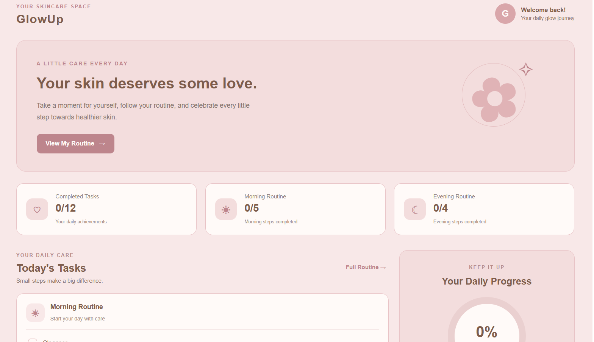
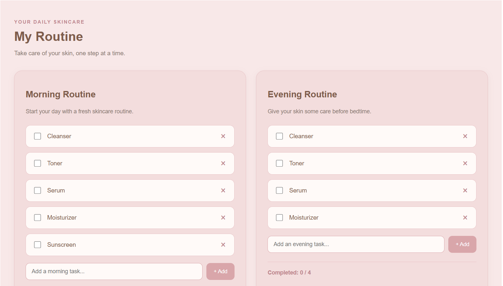
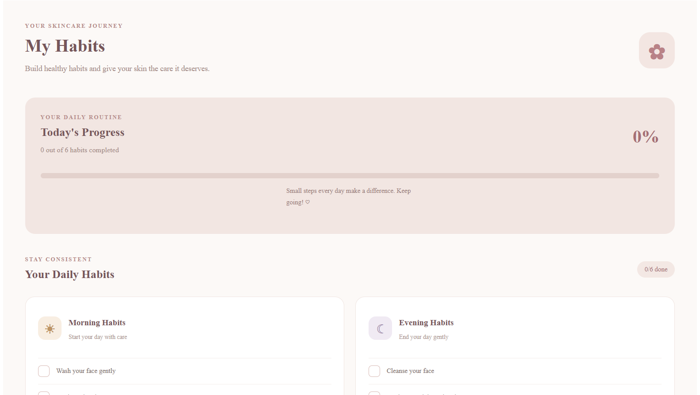
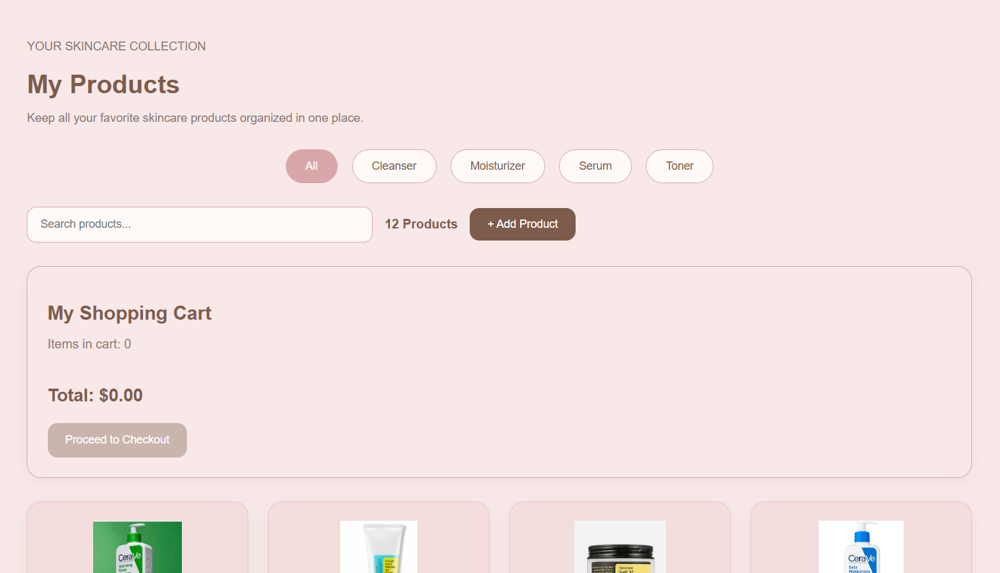
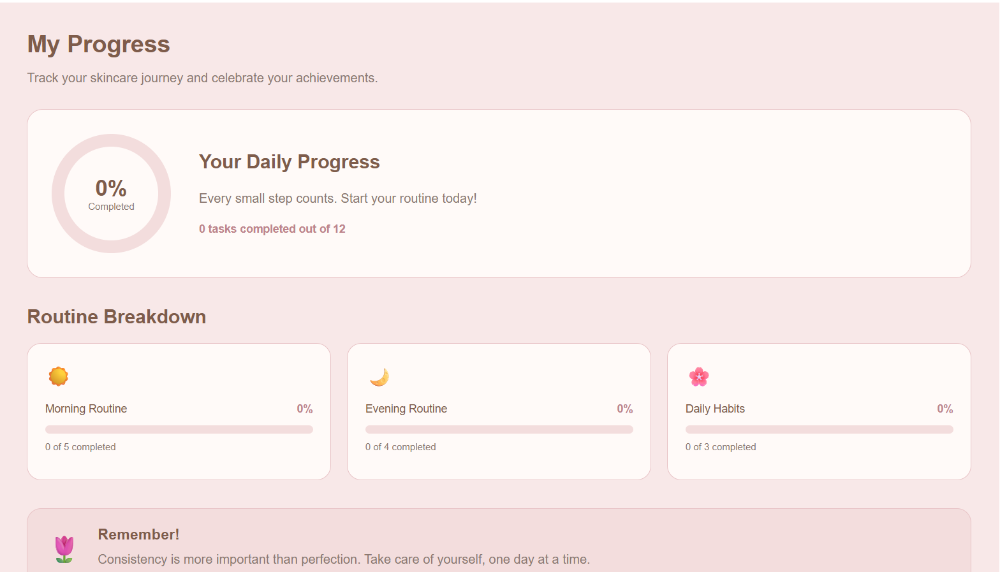
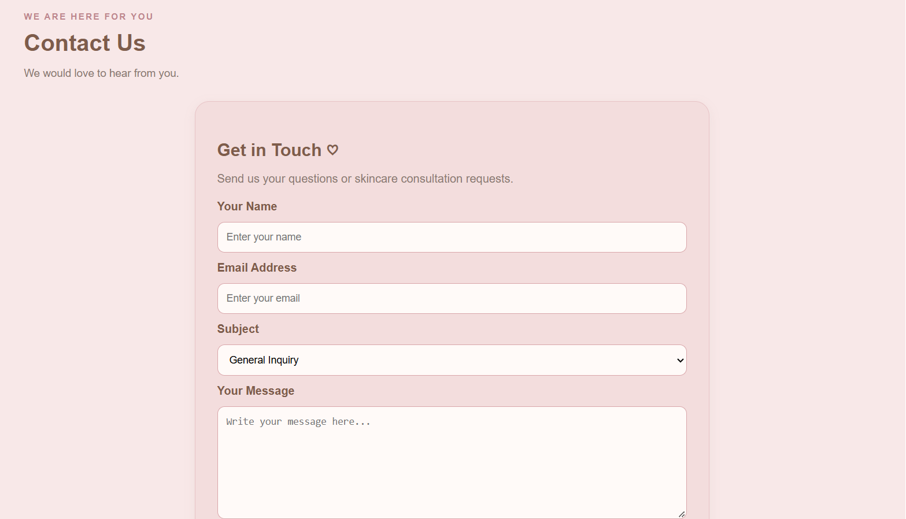

# GlowUp 🌸

## About the Project

GlowUp is a skincare and self-care web application designed to help users organize their skincare routines, track daily habits, and manage their skincare products.

The application provides a simple and user-friendly experience that encourages users to maintain consistent skincare habits and take better care of themselves.

## Features

- Dashboard to view daily skincare activities and progress.
- Morning and evening skincare routines.
- Daily skincare habits tracking.
- Skincare products browsing and management.
- Progress tracking to monitor completed tasks.
- Contact Us page.

## Technologies Used

- React.js
- JavaScript
- HTML5
- CSS3
- React Router
- Vite
- Git and GitHub

## Installation and Setup

### 1. Clone the repository

```bash
git clone https://github.com/52331045-lang/Glowup.git
```

### 2. Navigate to the project folder

```bash
cd Glowup
```

### 3. Install dependencies

```bash
npm install
```

### 4. Start the development server

```bash
npm run dev
```

### 5. Open the application

Open the local URL displayed in your terminal.

## Screenshots

### Dashboard



### My Routine



### My Habits



### My Products



### Progress



### Contact Us




## Team Members

- Student 1: Aya Abed
- Student 2: Sana Arbass

## Course Information

**Course:** CSCI426 – Advanced Web Programming

**University:** Lebanese International University

**Project:** GlowUp
